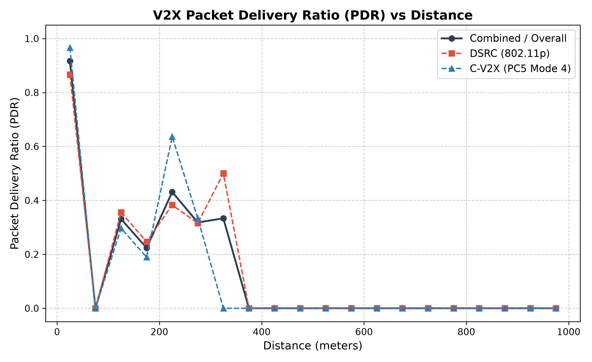
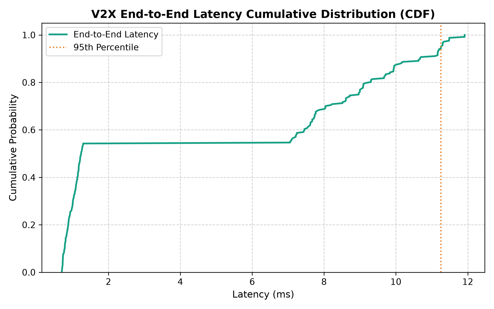

# DSRC ↔ LTE-C-V2X Bidirectional Gateway Simulator

[](https://www.python.org/downloads/)
[](https://opensource.org/licenses/MIT)
[]()
[]()

A standards-grounded, software-based **DSRC (IEEE 802.11p/1609) ↔ LTE-C-V2X (3GPP Release 14/15 PC5)** communication stack and bidirectional protocol gateway simulator implemented in Python on Windows.

> [!NOTE]
> **Simulation Disclaimer**: This is a protocol-level and wireless channel simulator. All physical layer models (MCS, SINR, PDR, path loss, fading) are validated statistical simulation models. Live RF transmission requires physical V2X transceivers (see [docs/hardware_interface.md](docs/hardware_interface.md)).

---

## 1. Key Features

- **SAE J2735 Basic Safety Message (BSM)**: UPER bit-exact encoding and decoding of Part I mandatory fields using ITU-T X.691 rules.
- **IEEE 1609.2 Security Processing**:
  - ECDSA-P256 signature generation and verification with SHA-256 digests.
  - Complete explicit PKI hierarchy (Root CA, Enrollment CA, Pseudonym CA, Vehicle Pseudonyms, Gateway RSU).
  - Replay protection with strict `generationTime` acceptance windows.
  - Unicast symmetric encryption support using AES-128-CCM.
- **DSRC Protocol Stack (US WAVE)**:
  - IEEE 1609.3 WAVE Short Message Protocol (WSMP-N/T) with variable-length PSID encoding ($0x0020$).
  - IEEE 802.11p OCB mode frame encapsulation (EtherType $0x88DC$, 32-bit CRC-32 FCS).
  - IEEE 1609.4 synchronized multi-channel operation (100 ms sync cycle, 50 ms CCH, 50 ms SCH, 4 ms guard).
  - 4-queue EDCA QoS prioritization (AC_VO for safety broadcasts).
- **LTE-C-V2X Sidelink Stack (3GPP Release 14/15 PC5)**:
  - 3GPP TS 36.212 SCI Format 1 generation and parsing (Priority, RRI, Freq Resource, Time Gap, MCS, Retx).
  - 3GPP TS 36.212 SL-SCH Transport Block framing with 24-bit CRC-24A polynomial `0x1864CFB`.
  - 3GPP TS 36.213 Mode 4 Sensing-Based Autonomous Sidelink Resource Selection (100 ms sensing window, candidate subframe selection, semi-persistent scheduling).
  - 3GPP TS 36.321 SL-SCH MAC priority queue management.
- **Bidirectional Protocol Gateway**:
  - Transparent translation between DSRC WAVE frames and LTE-C-V2X Sidelink Transport Blocks.
  - Ingress validation, structural checks, and original sender ECDSA trust chain verification.
  - Single-hop loop prevention and egress SHA-256 payload digest echo suppression.
  - Sliding-window $(vehicle\_id, msg\_cnt)$ deduplication (2.0s TTL).
  - Invariant preservation of raw UPER BSM payloads and gateway re-signing with gateway certificates.
  - Sub-10 ms mean transit pipeline latency.
- **Discrete-Event Simulation & Wireless Channel**:
  - SimPy process-based event scheduler.
  - 3GPP TR 36.885 & WINNER+ V2V path loss (Dual-slope Highway LOS, Urban LOS, Urban NLOS).
  - Rayleigh multipath fast fading, Rician LOS fading ($K$-factor), and log-normal slow shadowing.
  - Co-channel interference summation, thermal noise floor ($-97.0\text{ dBm}$), and sigmoid PDR curves.
  - Kinematic mobility models: highway lanes, waypoints, and 4-way urban intersections.

---

## 2. Standards-to-Code Mapping

| Standard | Layer / Topic | Source Implementation | Unit / Integration Test |
|:---|:---|:---|:---|
| **SAE J2735 / ITU-T X.691** | BSM Part I UPER Codec | `src/common/bsm_codec.py` | `tests/unit/test_bsm_codec.py` |
| **IEEE 1609.2-2016** | ECDSA-P256, SPDU, Certs | `src/common/ieee1609_2/` | `tests/unit/test_1609_2_security.py` |
| **IEEE 1609.3-2016** | WSMP-N/T Header & PSID | `src/dsrc/wave/wsmp.py` | `tests/unit/test_wsmp.py` |
| **IEEE 802.11p / 1609.4** | OCB Frame, Sync, EDCA | `src/dsrc/mac/`, `src/dsrc/wave/` | `tests/unit/test_wave_frame.py` |
| **3GPP TS 36.212 / 36.213** | SCI-1, CRC-24A, Mode 4 | `src/cv2x/pc5/`, `src/cv2x/mac/` | `tests/unit/test_pc5_sidelink.py` |
| **ETSI TS 102 890-1** | Gateway Loop & Dedup | `src/gateway/` | `tests/unit/test_gateway_validator.py` |
| **3GPP TR 36.885 / WINNER+** | V2V Channel Propagation | `src/simulation/channel/` | `tests/unit/test_channel_models.py` |

For the complete traceability table, see [docs/standards_traceability.md](docs/standards_traceability.md).

---

## 3. Quick Start (Windows PowerShell)

### Prerequisites
- Windows 10/11
- Python 3.11+
- PowerShell 5.1+

### Installation
```powershell
# 1. Navigate to workspace root
cd c:\sarthak\code\project\V2V

# 2. Run automated setup script
.\setup.ps1

# 3. Or install dependencies manually
pip install -r requirements.txt
```

---

## 4. Running the Simulator

### 4.1 CLI Scenarios
```powershell
# List all built-in scenarios
python main.py --list-scenarios

# Run Highway Simulation (12 vehicles, 5.0 seconds, gateway enabled, plots generated)
python main.py --scenario highway --duration 5.0 --vehicles 12 --generate-plots

# Run 4-Way Urban Intersection Simulation
python main.py --scenario intersection --duration 5.0 --vehicles 8 --generate-plots

# Run Mixed-Stack A/B Interoperability Benchmark (Gateway OFF vs Gateway ON)
python main.py --scenario mixed_stack --duration 4.0 --vehicles 10

# Generate simulated IEEE 1609.2 PKI certificates
python main.py --generate-pki
```

### 4.2 Sample Output: Highway Simulation Scenario

```powershell
python main.py --scenario highway --duration 5.0 --vehicles 10 --generate-plots
```

```text
========================================================================
   ____  ____  ____   ____    __  __  _   _   ___   ____  ____  ____ 
  |  _ \/ ___||  _ \ / ___|  |  \/  || | | | / _ \ / ___||  _ \|  _ \
  | | | \___ \| |_) | |      | |\/| || | | || | | | |    | |_) | |_) |
  | |_| |___) |  _ <| |___   | |  | || |_| || |_| | |___ |  _ <|  _ <
  |____/|____/|_| \_\\____|  |_|  |_| \___/  \___/ \____||_| \_\_| \_\
  
     DSRC (IEEE 802.11p) <---> LTE-C-V2X (3GPP Rel-14 PC5 Mode 4)
             Standards-Grounded Bidirectional Protocol Gateway
========================================================================

20:06:45.774 | INFO | main             | Running Highway Scenario: vehicles=10, duration=5.0s, gateway=True
20:06:45.779 | INFO | security.pki_gen | Generated Root CA [digest: 8cf7e55bd2467c2c]
20:06:45.780 | INFO | security.pki_gen | Generated Pseudonym CA [digest: cb9cac0d230b9bfa]
20:06:45.780 | INFO | security.pki_gen | Generated Gateway cert [digest: 6ab0cbd64b00f0ef]
20:06:45.783 | INFO | security.pki_gen | Simulated PKI ready: 1 Root CA, 2 Intermediate CAs, 1 Gateway Cert, 20 Vehicle Pseudonym Certs.
20:06:45.784 | INFO | simulation.eng   | Starting V2X simulation run: duration=5.0s, vehicles=10

[Real-time Gateway Ingress, Verification & Re-signing Pipeline]
20:06:45.895 | INFO | gateway.security | Gateway verified inbound SPDU: sender_cert='Vehicle-5-Pseudo-0' [digest: 64501fecaf564ea6] psid=0x0020 payload_len=37B
20:06:45.895 | INFO | gateway.security | Gateway re-signed outbound SPDU: gateway_cert='V2X-Gateway' [digest: 6ab0cbd64b00f0ef]
20:06:45.896 | INFO | gateway.core     | Gateway successfully translated DSRC -> C-V2X in 0.00ms: vehicle_id=af564ea6 msg_cnt=0
20:06:45.916 | INFO | gateway.security | Gateway verified inbound SPDU: sender_cert='Vehicle-2-Pseudo-0' [digest: 3208307295267c43] psid=0x0020 payload_len=37B
20:06:45.917 | INFO | gateway.security | Gateway re-signed outbound SPDU: gateway_cert='V2X-Gateway' [digest: 6ab0cbd64b00f0ef]
20:06:45.917 | INFO | gateway.core     | Gateway successfully translated C-V2X -> DSRC in 0.00ms: vehicle_id=95267c43 msg_cnt=0
...
20:06:51.324 | INFO | simulation.eng   | Simulation run complete. Total TX=500, Delivered=3756

========================================================================
 SIMULATION RUN SUMMARY: HIGHWAY (5.0s)
========================================================================
  Total BSM Broadcasts Transmitted:        500 packets
  Total Wireless Reception Attempts:      4295 packets
  Total Packets Successfully Decoded:     3756 packets
  Overall Packet Delivery Ratio:         87.45 %
------------------------------------------------------------------------
  Mean End-to-End Latency:                6.00 ms
  Median (P50) Latency:                   7.79 ms
  95th Percentile Latency:               11.61 ms
  99th Percentile Latency:               11.93 ms
------------------------------------------------------------------------
  Gateway Ingress Packets:                 459 packets
  Gateway Successfully Forwarded:          459 packets
  Gateway Dropped (Dedup/Loop/Sec):          0 packets
  Gateway Mean Transit Pipeline:          7.61 ms
========================================================================

📊 Exported CSV Reports:
   - results\reports\pdr_by_distance.csv
   - results\reports\summary_metrics.csv

📈 Generating publication plots with Matplotlib...
   - results\plots\pdr_vs_distance.png
   - results\plots\latency_cdf.png

Execution finished in 6.50 seconds.
```

#### Visual Simulation Results

<p align="center">
  
  
</p>

### 4.3 Mixed-Stack A/B Benchmark Results

```powershell
python main.py --scenario mixed_stack --duration 4.0 --vehicles 10
```

```text
========================================================================
 MIXED-STACK INTEROPERABILITY A/B BENCHMARK RESULTS
========================================================================
  WITHOUT GATEWAY (Isolated Stacks):
    - Delivered Packets:                 1265
    - Overall PDR:                      79.06 %
  WITH GATEWAY (Bidirectional Translation):
    - Delivered Packets:                 2942
    - Overall PDR:                      86.66 %
    - Gateway Forwarded:                  359
    - Gateway Transit Pipeline:          7.66 ms
------------------------------------------------------------------------
  INTEROPERABILITY RECEPTION GAIN:   +  132.6 %
========================================================================
```

---

## 5. Automated Tests & Code Coverage

Execute the automated test suite covering all units and end-to-end integration:

```powershell
# Run all unit and integration tests
python -m pytest tests/ -v

# Run with full coverage report
python -m pytest tests/ --cov=simulation --cov=vehicles --cov=gateway --cov=cv2x --cov=dsrc --cov=common --cov-report=term-missing
```

**Results:**
- **188 Passed** in ~5.6 seconds.
- **90% statement coverage** across 3,205 statements.

---

## 6. Project Architecture & Directory Layout

```
V2V-Gateway/
├── src/
│   ├── dsrc/                   # IEEE 802.11p / 1609 WAVE Stack
│   │   ├── application/        # BSM generator & sequence manager
│   │   ├── security/           # IEEE 1609.2 certificate & signer
│   │   ├── wave/               # WSMP-N/T & 802.11p OCB frame
│   │   ├── mac/                # 1609.4 sync & EDCA QoS scheduler
│   │   ├── phy/                # 10 MHz OFDM statistical sensitivity model
│   │   └── stack.py            # DSRCStack facade
│   ├── cv2x/                   # 3GPP Release 14/15 PC5 Sidelink Stack
│   │   ├── application/        # Priority-tagged BSM generator
│   │   ├── security/           # PC5 IEEE 1609.2 security handler
│   │   ├── pc5/                # SCI Format 1, CRC-24A, Mode 4 pool
│   │   ├── mac/                # SL-SCH prioritization & queue
│   │   ├── phy/                # 1.0 ms subframe SC-FDMA model
│   │   └── stack.py            # CV2XStack facade
│   ├── gateway/                # Bidirectional Protocol Gateway
│   │   ├── receiver.py         # Ingress dissection & demux
│   │   ├── validator.py        # SPDU & BSM syntax validation
│   │   ├── loop_prevention.py  # Signer identity & payload echo check
│   │   ├── duplicate_handler.py# Sliding-window dedup cache
│   │   ├── security_handler.py # Original verification & Gateway re-sign
│   │   ├── translator.py       # DSRC <-> C-V2X bidirectional translation
│   │   ├── forwarder.py        # Egress queue & latency tracking
│   │   └── gateway.py          # V2XGateway facade
│   ├── common/                 # Shared protocols, crypto, config
│   │   ├── bsm_codec.py        # SAE J2735 BSM Part I UPER codec
│   │   ├── ieee1609_2/         # ECDSA-P256, SPDU, certificates
│   │   ├── config_schema.py    # Pydantic scenario schemas
│   │   ├── message_types.py    # Protocol constants & PSIDs
│   │   ├── exceptions.py       # Domain exception hierarchy
│   │   └── hardware_interface.py # Hardware radio driver abstraction
│   ├── vehicles/               # Fleet kinematics & mobility models
│   ├── simulation/             # SimPy DES engine, channel, scenarios
│   └── monitoring/             # Structured Loguru logging
├── configs/                    # YAML scenario definitions
├── certificates/               # Simulated PKI generator
├── asn1/                       # BSM Part I ASN.1 definition
├── docs/                       # Comprehensive documentation suite
│   ├── architecture.md
│   ├── standards_traceability.md
│   ├── security_design.md
│   ├── deviations.md
│   └── hardware_interface.md
├── results/                    # Generated logs, CSV reports, PNG plots
│   ├── reports/
│   │   ├── pdr_by_distance.csv
│   │   └── summary_metrics.csv
│   └── plots/
│       ├── pdr_vs_distance.png
│       └── latency_cdf.png
├── main.py                     # CLI entry point
├── pytest.ini                  # Pytest configuration
├── requirements.txt            # Pinned Python dependencies
└── setup.ps1                   # Automated setup script
```

---

## 7. Documentation Suite

- [Architecture & Data Pipelines](docs/architecture.md)
- [Standards Traceability Matrix](docs/standards_traceability.md)
- [Security Design & PKI Hierarchy](docs/security_design.md)
- [Documented Deviations & Simplifications](docs/deviations.md)
- [Hardware Radio Interface Guide](docs/hardware_interface.md)

---

## 8. License

MIT License — Copyright (c) 2026 Sarthak Borse.
